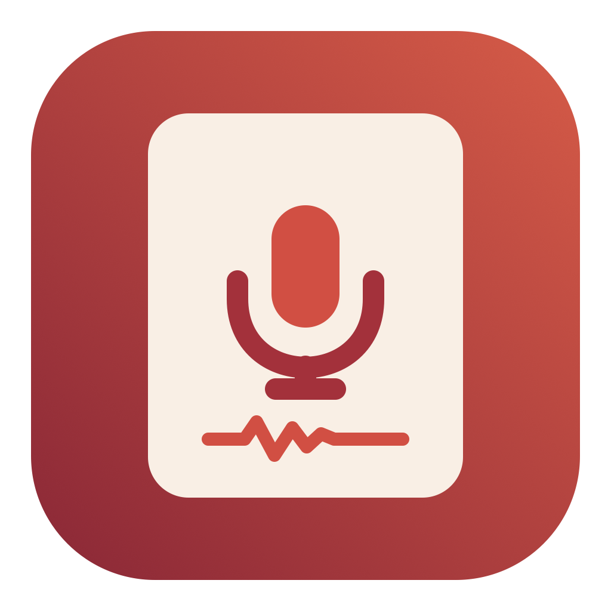
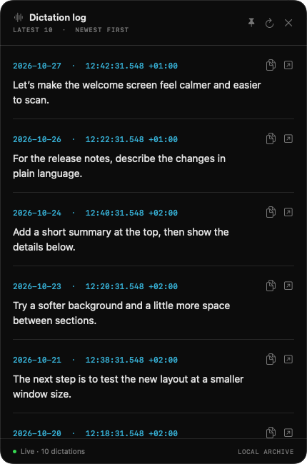

# Codex Dictation Console

A local macOS archive for dictations captured by Codex. It keeps available transcripts and original audio together so you can search, listen, and return to them after Codex's local history rotates.

## What it does

- Watches `~/.codex/dictation-history` and saves available recordings and metadata to a local archive. Closing the window keeps capture running; quitting the app stops it. Open at Login is optional.
- Searches transcript history, plays original audio, shows surrounding dictations, and provides a floating view of recent dictations.
- Preserves source metadata and transcript revisions, and exports recordings with their metadata and checksums.
- Offers separate transcript recovery attempts using on-device macOS speech recognition or, when explicitly selected, Codex transcription. Recovery does not replace the original transcript or audio.
- Keeps deleted recordings in Recently Deleted until you permanently delete them.

## Preview

The floating log shows recent saved dictations. This example uses fictional text.



## Requirements and building

The project targets macOS 14 or later and requires Xcode 26 or later, including its macOS SDK, and Python 3. On-device transcript recovery requires macOS 26 or later, a supported language and hardware; macOS may need to download a speech model.

To compile the source and run the tests:

```sh
swift build --build-system native
swift test --build-system native
```

To create a local app bundle:

```sh
./build-app.sh
```

The bundle is written to `dist/Codex Dictation Console.app`; the script will not overwrite an existing bundle. Move it to `~/Applications` before enabling Open at Login. The script uses ad-hoc signing by default; set `CODE_SIGN_IDENTITY` to an available signing identity to sign with it. Ad-hoc signing may not provide a stable identity across rebuilds for macOS login-item registration. The bundle is not notarized for public distribution. The app uses the same archive and bundle identity as other installations of Codex Dictation Console on the same account.

## Privacy and storage

The source history is read-only. The managed archive is stored at `~/Library/Application Support/Codex Dictation Lab/Archive` and contains recordings, transcripts, and metadata. Exports also contain this material; treat both as sensitive. Deleting a recording in the app affects the managed archive, not the source history. Permanently delete items from Recently Deleted to remove them from the archive.

Archiving and on-device recovery run locally. **Transcribe with Codex** explicitly uploads the selected audio to OpenAI and uses the existing ChatGPT sign-in in `~/.codex/auth.json`. This option uses an undocumented endpoint observed in Codex Desktop, requires an active ChatGPT session and internet access, and may stop working if that endpoint changes. API-key sign-ins and automatic token refresh are not supported.

## Limitations

The app can preserve only material that exists in Codex's local history while capture is running and storage is available. It cannot recover audio or text that was never saved or disappeared before capture, guarantee transcription accuracy, or verify that dictated text reached its intended field. It cannot determine an exact per-dictation cost from local history. Codex's local history format and the remote transcription endpoint are not stable public interfaces and may change.


The test suite skips its live transcription test unless `CODEX_RECOVERY_LIVE_AUDIO` is set. Setting it uploads the specified audio using the current Codex ChatGPT sign-in.
